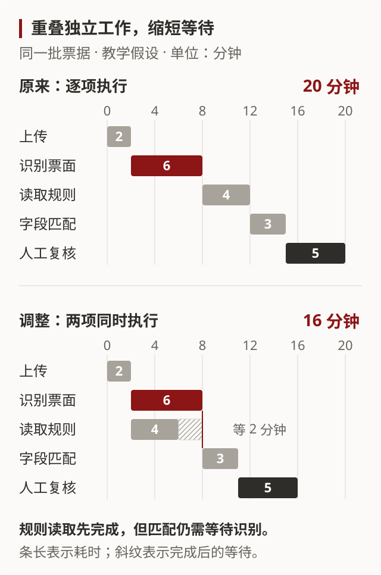
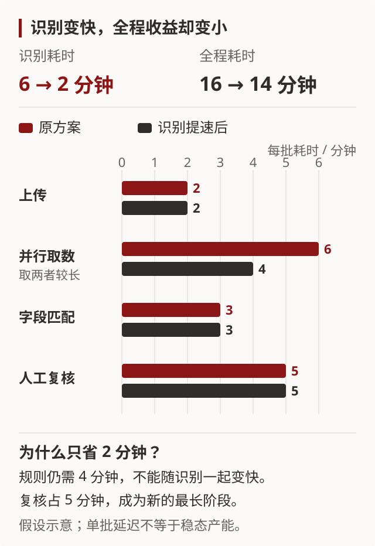

# 为什么识别更快，归档仍然慢？

这是一个完全虚构的图文解释样例，用来演示如何把技术原理、趋势判断和反方解释放进同一条逻辑。所有时长均为教学假设，没有引用真实企业、客户或行业数据。

## 当前判断：客户买的是完成归档

假设一个服务替企业把一批票据归档：先上传文件，识别票面内容，再根据企业的科目规则匹配字段，最后由人复核。客户等的是整批文件可以使用，而非某个识别模型完成计算。

在下面的假设里，把识别从 6 分钟加速到 2 分钟，全程却只缩短 2 分钟。这提示了一条**有条件的商业推论**：如果各家识别能力越来越接近，单独出售识别速度可能更难收费；能减少规则适配和异常复核的服务，才可能进一步缩短客户的等待。不过，耗时变长的环节并不一定有更高利润，后文给出了相反路径。

## 技术原理：有些工作可以同时做，有些必须等

一批文件上传需要 2 分钟。识别票面需要 6 分钟，读取企业已知的科目规则需要 4 分钟。这两件事彼此独立，可以同时开始。字段匹配则必须等两者都完成，之后还需人工复核。

**图 1 的结论：并行省下的是原本可以重叠的工作时间。** 同时执行不意味着每一步都变快。原来全程为 2 + 6 + 4 + 3 + 5 = 20 分钟；调整后为 2 + max(6, 4) + 3 + 5 = 16 分钟。这里的 max 表示“等两个任务中较慢的那个完成”。

关键前提是企业身份已经明确，科目规则可以提前读取。若必须先识别票据内容才能决定取哪套规则，两项工作就不能这样并行；这是一条会改变方案选择的依赖关系。

## 条件趋势：一个部件变快以后，难点会转移

接着假设识别从 6 分钟降到 2 分钟，其余环节不变。并行阶段仍然要等 4 分钟的规则读取，所以全程变成 2 + max(2, 4) + 3 + 5 = 14 分钟。

**图 2 的结论：识别耗时下降约 67%，全程仅缩短 12.5%。** 继续加速识别已经不能缩短这批任务的等待，除非同时改变规则读取的依赖或耗时。人工复核也值得关注，但“最长阶段”不能直接用于推算产能：实际吞吐还取决于各环节有多少资源，以及是否能同时处理多批文件。

这如何变成行业观点？需要把技术变化接到客户采购上。若客户逐渐把识别视为标准组件，却仍为大量异常付出人工成本，那么需求可能转向更完整的归档服务，收费依据也可能从“识别多少页”转向“多少文件无需返工即可用”。这一推论需要客户愿意为端到端结果付费，且服务商能复用规则和处理经验。

最有力的反方是：规则获取和异常处理也可能迅速自动化，客户又能轻易切换服务商。此时节省的成本会通过竞争转给客户，行业不会因为瓶颈转移就自然产生高利润。若新增收入必须依靠同等增长的人力，所谓完整服务也可能只是劳动密集的定制交付。

因此，在这个假设场景里，值得判断的是：**同类客户增加后，完成一批文件所需的人工是否持续下降，客户是否仍愿意为最终结果付费。** 仅知道某个识别模型更快，还不足以得出公司具有竞争优势的结论。本示例没有真实行业证据，不能据此作出实际投资判断。

## 动手看：改变输入，找出收益停止的位置

[打开交互示例：调节识别和复核时间，切换并行执行](receipt-interactive.html)。把识别从 6 分钟逐渐调到 2 分钟，观察它为什么在 4 分钟以下不再缩短全程；再关闭并行，观察同一参数为什么产生不同结果。页面会显示公式和每段工作的位置，并支持键盘操作及打印。

上面两张 SVG 是默认假设下完整、可打印的静态解释；即使不打开交互页面，也能理解核心结论。SVG 本身是可编辑源文件；交互页面的 HTML 和 JavaScript 完整保存在本地，不需要网络或外部库。

## 主要来源与假设

来源：作者为解释机制构造的教学假设；不是测量结果、企业口径或市场预测。

| 环节 | 初始耗时 | 提速情景 | 依赖 |
| --- | --- | --- | --- |
| 上传 | 2 分钟 | 2 分钟 | 任务开始 |
| 识别票面 | 6 分钟 | 2 分钟 | 上传完成 |
| 读取规则 | 4 分钟 | 4 分钟 | 并行时只需上传完成；串行时还要等识别 |
| 字段匹配 | 3 分钟 | 3 分钟 | 识别和规则均完成 |
| 人工复核 | 5 分钟 | 5 分钟 | 匹配完成 |

模型忽略资源争用、网络波动、返工和多批调度，只比较一批任务的完成时间。改变这些假设，可能改变时间收益及商业推论。
